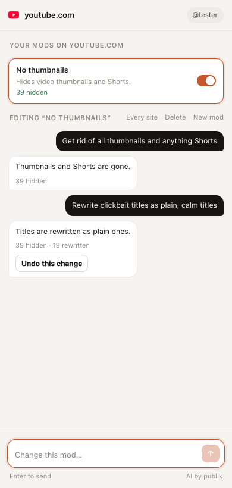

# Remold

**Make the internet yours again.** Remold is a Chrome extension: open it on any website, say how you want the site to look or behave, and it changes. Free and open source (MIT).

- "Hide posts on X that look AI-written" → an AI reads each post and collapses the ones that are.
- "Get rid of thumbnails and Shorts on YouTube" → gone, on every page of YouTube, every visit.
- "Warm paper colours and a serif font" → the whole site restyled.
- "Open YouTube on my subscriptions" → the home feed redirects.
- **Context from your other tabs:** remold one site using what's in the others. On YouTube: "only show videos from creators in my X feed". Remold reads your X tab (or opens a page for you, signed in as you), puts those names into the mod, and keeps them. Tabs in the same tab group are the context; with no group, every tab in the window.
- **Memory:** Remold keeps short notes about your taste from every chat (and the full history of each mod) and uses them on every site. See and delete everything in the panel: menu → Everything you've made / Memory.



## Install

Until it's on the Chrome Web Store:

1. Download `remold-0.4.0.zip` from [Releases](https://github.com/VedSoni-dev/remold/releases) and unzip it.
2. Open `chrome://extensions`, turn on **Developer mode** (top right), click **Load unpacked**, pick the unzipped folder.
3. Click Remold's icon (or ⌘⇧Y / Ctrl+Shift+Y). The side panel opens.
4. **Sign in with publik**. AI runs on your publik plan.

## How it works

You talk; the AI writes a **mod** in the Remold kit, a small declarative format the extension runs on the page. The AI doesn't write page code by default, so a mod is safe to run, easy to read and easy to change.

| kit piece | what it does |
|---|---|
| `css` | any styling: colours, fonts, widths, layout |
| `hide` | selectors to remove |
| `filters` | AI judges each item in a list (posts, videos, comments) against your rule and hides, collapses, blurs or dims the matches. Each item is judged once and cached |
| `ai` | AI on **anything on screen**, live as you scroll: ask a question about each element and act on the answer: hide/collapse/blur/dim (yes/no), a badge (e.g. each post's tone), new text (translate, summarise), or a style picked from categories (colour-code by topic) |
| `match` | keep or hide items by a list of names/words (often read from another tab); instant, no AI per item |
| `rewrite` | AI rewrites short texts, like clickbait titles |
| `replace` | regex text swaps |
| `inject` | static HTML added to the page (scripts and handlers stripped) |
| `actions` | small interactions: on load, on click or on a key → hide, toggle, click, scroll, focus, add a class, open a URL |
| `redirect` | send one path to another |
| `js` | custom code, only if you turn on **Custom code** (Chrome's `userScripts` API and its "Allow User Scripts" switch). It gets `window.remold`, real-time AI through your publik account (below) |

### AI in your own code: `window.remold`

With Custom code on, a mod's JavaScript can call publik's AI live, on whatever is on screen:

```js
remold.onScreen("article", async (post) => {           // runs as each post scrolls into view
  const [tone] = await remold.label([post], "tone in one word");
  remold.badge(post, tone);
});
await remold.judge(els, "is this an ad?");             // → [true, false, …]
await remold.pick(els, "topic", ["tech", "sport", "politics"]);
await remold.rewrite(els, "translate to Spanish");
await remold.ai(`Summarise: ${remold.screenText()}`);  // free-form, { json: true } for JSON
```

Answers per element are cached by text, so a post is only judged once.

When you ask, Remold reads an outline of the page (tags, test ids, roles, labels, the repeated item lists), the AI writes the mod, Remold tries it on the page, counts what each selector matched, and if something matched nothing it sends that back and the AI fixes it once before saving. Every mod has an on/off switch, live counts ("5 of 30 filtered"), undo, and can apply to one site or every site.

**Context from other tabs.** You always remold the site you're on. When you ask for something that needs another site ("only show YouTube videos from creators in my X feed", "hide LinkedIn posts from people I don't follow on X"), the AI asks to read that tab first: Remold reads it (the items on the page, with links), or opens a page in a background tab signed in as you (up to 6 reads, two rounds), and the AI writes the mod with that data in it, usually as a `match` list (fast, no AI per item). The mod remembers where its data came from; **Refresh context** re-reads it. The panel shows which tabs Remold can read: the other tabs in this tab group, or every tab in the window.

**Memory.** Each mod keeps its whole conversation (older turns go along as a recap). Remold also keeps short notes about your taste ("hates engagement bait", "likes warm serif themes") and uses them, plus your other mods on the site, in every chat. Everything is in the panel's library: toggle or delete any mod on any site, delete any memory note, add one by hand, forget everything.

## Privacy

- Mods, memory and the filter cache live in your browser (`chrome.storage.local`).
- To write a mod, the page's outline and your request go to publik's AI. Filters send the text of the items they judge. Nothing else leaves your browser.
- Your publik key stays in the extension's local storage and is only sent to publikhq.com.
- Usage counting follows publik's rules (`app_opened`, `active_session`), plus an anonymous count for the builds hub (build, event, a random id; no content, no account).

## Develop

No build step. Load the folder unpacked; edit; click reload on `chrome://extensions`.

```
src/background.js   service worker: publik, AI calls, mod generation (with context + memory), filter cache
src/publik.js       Sign in with publik, usage counting, publik API
src/prompts.js      the Remold kit as the AI sees it
src/content.js      runs mods on pages and reads pages for the AI
src/panel.*         the side panel
test/smoke.cjs      loads the extension in Chromium: gate, runtime on YouTube
test/e2e.cjs ONLY=ctx  YouTube remolded with names read from another tab (test/fixtures), then the library
test/e2e.cjs        the panel flow end to end (with test/mock-publik.cjs, or real publik)
./build.sh          dist/remold-<version>.zip
```

## Not yet

- Gemini and your own API keys (publik only for now).
- Chrome Web Store listing.
- Context reads what a tab has rendered (it scrolls a little to load more); very long feeds are sampled. X and LinkedIn must be open and signed in.

Built by [@forkthis_ai](https://x.com/forkthis_ai). Free on publik.
